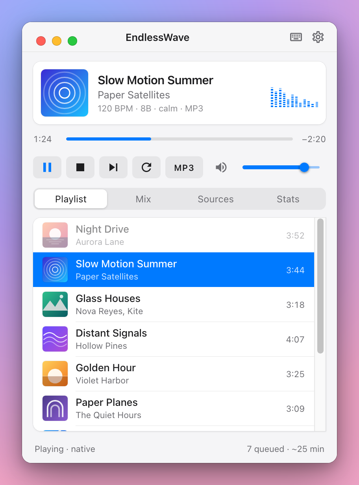
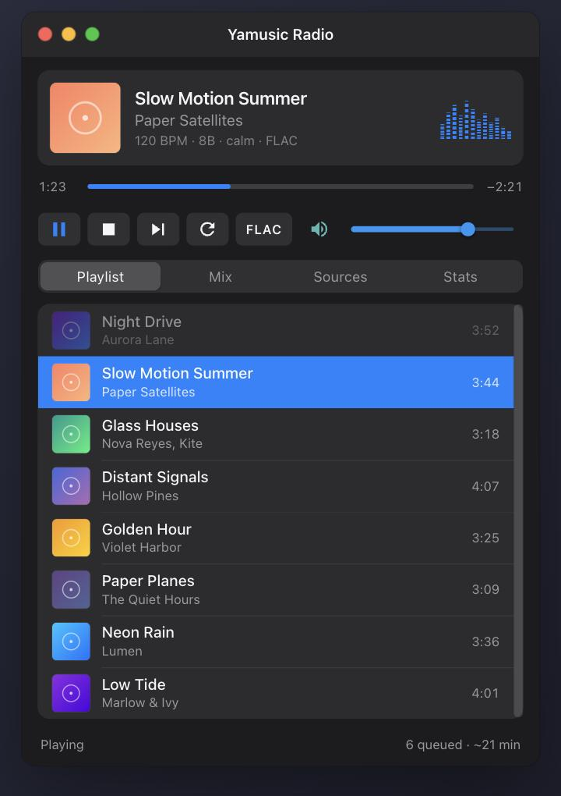
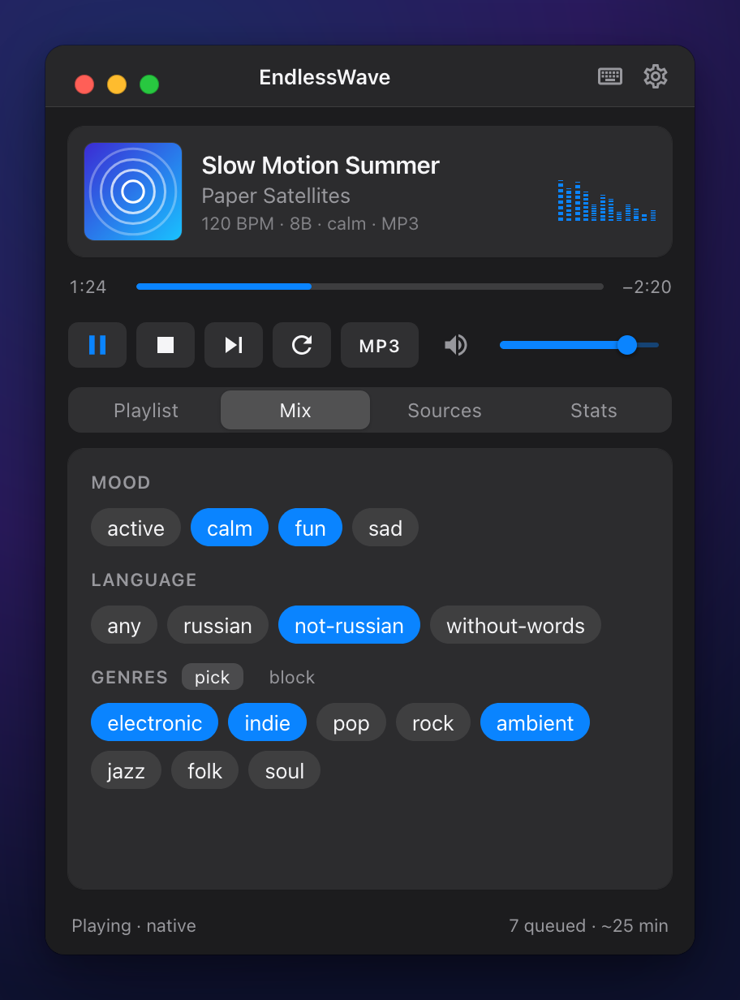

<h1 align="center">Yamusic Radio Player</h1>

<p align="center">
  A tray player for the endless DJ radio <a href="https://github.com/vm86/yamusic-radio">yamusic-radio</a>:<br>
  tracks from Yandex Music or your own folder, beat-matched and blended into one continuous mix.
</p>

<p align="center">
  
  &nbsp;
  
</p>

## What is it

**yamusic-radio** takes tracks from a Yandex Music station (or from a folder of music files), matches
their tempo, swaps the bass and mids at the joins and streams the result as one endless mix with no
gaps. On its own it is a service without a window. **Yamusic Radio Player** gives it an interface:

- it starts the service for you and stops it with itself, so there is nothing to set up in a terminal;
- it plays the mix (MP3 or lossless FLAC) and shows what plays, what comes next and how the blends go;
- it lives in the tray and answers to the media keys and the system's Now Playing (Control Center on
  macOS, MPRIS on Linux);
- it runs on **macOS** (Apple Silicon) and **Linux** (x86_64), in light or dark mode as the system has it.

The packages already hold the radio service and ffmpeg: nothing else has to be installed, no `ffmpeg`
and no Python.

## Features

| | |
|---|---|
| **A mix without gaps** | Beat-matched blends: bass swap, three-band EQ blend, filter sweeps, effects. Keys are chosen to sound harmonic |
| **The queue under control** | Drag the tracks to reorder them, take out the ones you do not want, play any of them at once |
| **Mood, genres, language** | Pick the mood (`calm`, `fun`...), the genres to play and the genres never to play, the language of the music |
| **Sources** | Yandex Music and/or a local folder (`mp3`, `flac`, `m4a`, `ogg`, `opus`, `wav`...). Both can play at once |
| **MP3 or FLAC** | A switch for the stream: MP3 at 320 kbit/s, or lossless FLAC (16 bit) |
| **Spectrum** | The real spectrum of the mix, in time with the sound |
| **The system** | Tray, media keys, Now Playing with the cover, keyboard shortcuts, hide to the tray |
| **Statistics** | How many blends there were and how well tempo and key matched |

<p align="center">
  
</p>

## Install

Download a package from the [Releases](../../releases) page.

**macOS** (Apple Silicon): open the `.dmg` and drag the app to Applications. The build is not signed, so
macOS asks to confirm the first start: *System Settings → Privacy & Security → "Open Anyway"* (or
right-click the app → "Open").

**Fedora** (RPM):

```bash
sudo dnf install ./yamusic-radio-player-*.x86_64.rpm
```

**Debian / Ubuntu** (DEB):

```bash
sudo apt install ./yamusic-radio-player_*_amd64.deb
```

The window needs the GStreamer plugins to play sound (`gstreamer1-plugins-good` or
`gstreamer1.0-plugins-good`); the package pulls them in. For the tray icon, GNOME needs the AppIndicator
extension.

## First start and setup

Open the app: the radio service starts by itself (port `18000`, on `127.0.0.1` only).

### Signing in to Yandex Music

If you have not signed in yet, a card "Sign in to Yandex Music" shows at the top:

1. Press **Copy code** (the code goes to the clipboard) and **Open**: the Yandex page opens.
2. Paste the code and confirm the sign-in.

The token is kept in `~/.config/yamusic-radio.json` (mode `0600`), so you sign in once.

### Music from a folder

Open **Sources** → turn **Local folder** on → **Choose…** → pick the folder. Subfolders are read too, and
the tags (title, artist, genre) come from the files. Yandex Music can stay on or be turned off: the tracks
of both sources go into one pool.

> Local tracks have no covers and no moods: the mood is judged by the sound. The language setting works
> for Yandex Music only.

### Mood, language, genres

The **Mix** tab:

- **Mood**: pick one or several. None picked means any;
- **Language**: the language of the music (Yandex Music);
- **Genres**: the **pick** mode chooses the genres to play, **block** the ones never to play. The list of
  genres grows as tracks are played.

A choice takes effect at once: the queue is built again for the new settings. You can rebuild it by hand
with the **⟳** button (⌘R). The settings are remembered and come back after a restart.

## Using it

<table>
<tr>
<td><b>Buttons</b></td>
<td>▶/⏸ play and pause · ■ stop · ⏭ next track · ⟳ rebuild the queue · <b>MP3/FLAC</b> the stream format · the volume slider</td>
</tr>
<tr>
<td><b>Next track</b></td>
<td>The blend starts on the next bar line and is as smooth as any other. The button stays pressed until the new track is heard</td>
</tr>
<tr>
<td><b>The queue</b></td>
<td><b>Drag</b> a track with the mouse to move it. Hover a row: <b>▶</b> plays it now (or double-click), <b>✕</b> takes it out of the queue. The track being blended in just now is fixed</td>
</tr>
<tr>
<td><b>Tray</b></td>
<td>The menu: what plays, pause, next, show the window, quit. Closing the window only hides it to the tray; <b>Quit</b> stops the app and the service</td>
</tr>
<tr>
<td><b>System</b></td>
<td>Media keys and Now Playing (Control Center on macOS, MPRIS and <code>playerctl</code> on Linux)</td>
</tr>
</table>

### Keyboard shortcuts

On macOS the shortcuts are in the menu bar (**Controls** and **View**), so you can find them there. On Linux, Ctrl takes the place of ⌘. The whole list is shown by <kbd>⌘</kbd> <kbd>/</kbd>.

| Key | Action |
|---|---|
| <kbd>Space</kbd> | Play / pause |
| <kbd>⌘</kbd> <kbd>.</kbd> | Stop |
| <kbd>⌘</kbd> <kbd>→</kbd> | Next track |
| <kbd>⌘</kbd> <kbd>R</kbd> | Rebuild the queue |
| <kbd>⌘</kbd> <kbd>L</kbd> | MP3 ⇄ FLAC |
| <kbd>⌘</kbd> <kbd>↑</kbd> / <kbd>↓</kbd> | Volume |
| <kbd>⌘</kbd> <kbd>1</kbd>–<kbd>4</kbd> | Tabs: Playlist, Mix, Sources, Stats |
| <kbd>⌘</kbd> <kbd>/</kbd> | The list of shortcuts |

## How it works

```
┌──────────────────────────┐   HTTP API, SSE, /stream    ┌──────────────────────────┐
│  Yamusic Radio Player    │ ◄─────────────────────────► │  yamusic-dj (service)    │
│  Tauri + Vue 3           │      127.0.0.1:18000        │  Python, the mix in numpy│
│  window, tray, sound     │                             │  ├─ ffmpeg: MP3 and FLAC │
└──────────────────────────┘                             │  └─ Yandex Music / folder│
                                                         └──────────────────────────┘
```

The window plays the stream with a plain `<audio>`; everything else (the queue, the moods, the spectrum)
comes from the API of the service. If a service already runs on port `18000`, the app connects to it.

Files of the service:

| What | Where |
|---|---|
| The Yandex Music token | `~/.config/yamusic-radio.json` |
| The cache of the analysis, the settings | `~/.cache/yamusic-radio.db` |
| The loaded tracks that wait for their turn | `~/.cache/yamusic-radio-tracks/` |
| The log (only with `YAMUSIC_RADIO_LOG=1`) | `~/.cache/yamusic_radio.log` |

Environment: `YAMUSIC_RADIO_PORT` (the port, 18000 by default), `YAMUSIC_RADIO_ARGS` (any more flags of
the service, e.g. `--no-keep-tracks`), `YAMUSIC_RADIO_LOG=1` (write the log of the service to a file; it is not written otherwise), `YAMUSIC_RADIO_DEBUG=1` (a detailed log, to the file too), `YAMUSIC_DJ_BIN` (your own
binary of the service).

## Troubleshooting

- **No sound, the queue is empty.** The service is waiting for tracks. The log is not written by default.
  Start the app with the log on, then read it: on macOS
  `open -n --env YAMUSIC_RADIO_LOG=1 -a "Yamusic Radio Player"`, on Linux
  `YAMUSIC_RADIO_LOG=1 yamusic-radio-player`, and `tail -f ~/.cache/yamusic_radio.log`.
  `Unknown HTTPError` in it means Yandex Music does not answer or limits the requests.
- **An old service is left after an update.** Stop it and restart the app: `pkill -f yamusic-dj`.
- **No tray icon on Linux.** AppIndicator is needed (in GNOME, the *AppIndicator and
  KStatusNotifierItem Support* extension). The tray menu still works, a click on the icon does not open
  the window.
- **No sound in the window on Linux.** Install `gstreamer1-plugins-good` and `gstreamer1-plugins-base`.

## Development

You need Node.js 22+, Rust (stable) and, to develop, the radio service next to the project.

```bash
npm install
npm run tauri dev      # the window, with hot reload
```

In development the service is taken from `../yamusic-radio/.venv/bin/yamusic-dj`, then from `PATH`;
`YAMUSIC_DJ_BIN` sets another one. Type check: `npx vue-tsc --noEmit`.

The app icon is drawn in `assets/icon.svg` (render it to `assets/icon.png`, 1024 px, then
`npx tauri icon assets/icon.png` makes all the sizes); the menu bar icon of macOS is
`src-tauri/icons/tray.png` (`assets/tray.svg`).

Layout: `src/` is the interface (Vue 3, Vuetify), `src-tauri/` the shell (starts the service, the tray, the
window), `scripts/` builds the service, ffmpeg and the packages.

## Build

The packages hold the service (built from [vm86/yamusic-radio](https://github.com/vm86/yamusic-radio)
with PyInstaller) and a static LGPL ffmpeg.

| Platform | Result | Command |
|---|---|---|
| macOS arm64 | `.app` / `.dmg` | `npm run bundle` on a Mac |
| Linux x86_64 | `.rpm`, `.deb` | `npm run bundle:linux` (in a podman container) |

## Limits

- The macOS build is not signed or notarized (that needs a Developer ID certificate).
- Apple Silicon only on macOS, x86_64 only on Linux.
- This is a radio: there is no previous track and no seeking.
- On Linux the window frame of the system is drawn together with the app's own top bar.

## License

The player is released under the [MIT License](LICENSE).

### Third-party parts

- **ffmpeg 9.0.2** (LGPL-2.1+) and **LAME 4.0** (LGPL): built without any GPL parts; the license text is
  next to the binary in the package.
- **Essentia** (AGPL-3.0): part of the `yamusic-dj` service, finds the keys of the tracks (see its
  [README](https://github.com/vm86/yamusic-radio#readme)). Keep this in mind when you distribute the
  packages.
